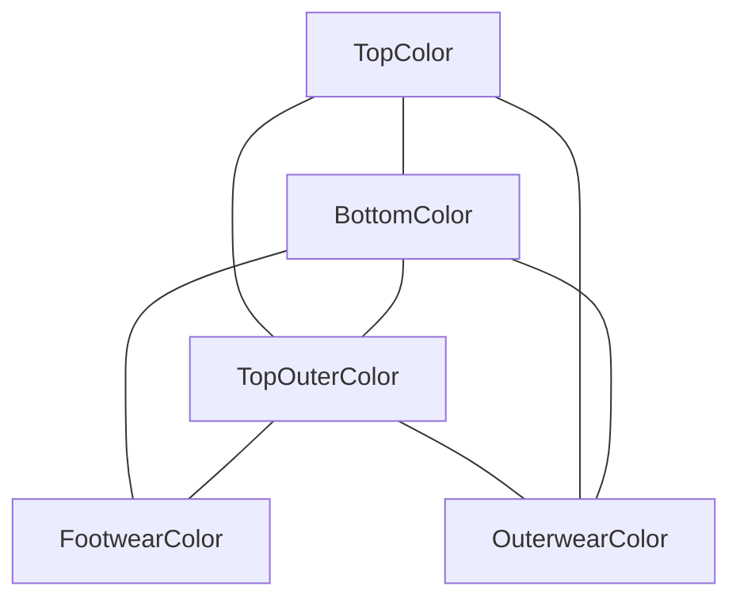

# Technical Documentation: Outfit Color Matching Filters

This document provides a comprehensive overview of the two color-filtering methods engineered for the Twelve70 Outfit Builder. It is structured to help you present these architectures to engineering and product teams at the Company.

---

## Executive Summary: The Architectural Challenge

The primary challenge of a multi-garment outfit recommender system is **combinatorial space complexity**. 

If we have 5 categories of garments (Top, Bottom, Outerwear, Footwear, Top Outer) and $N$ colors per category:
- Storing every complete valid outfit configuration requires a table of size $O(N^5)$.
- If $N = 50$, the potential combination space is **$312,500,000$ outfits**. 
- Adding just **one new color** to a single category (e.g., adding "sage green" to bottoms) requires generating up to $50^4 = 6.25 \text{ million}$ new database rows to pair it with every other existing item! This is a **combinatorial explosion** that results in massive table bloat and high maintenance overhead.

To solve this, we have provided two separate filters:
1. **The Sequential Filter**: A fast, step-by-step wizard matching complete historical database records.
2. **The Any-Sequence Pairwise Filter**: An advanced graph-based compatibility solver that reduces complexity to $O(N^2)$, enabling complete selection flexibility in any order while preventing database explosion.

---

## Method 1: The Sequential Outfit Filter

### 1. User Experience Flow
`Select TOP` → `Filter/Select BOTTOM` → `Filter/Select OUTERWEAR` → `Filter/Select FOOTWEAR` → `Predict TOP_OUTER`

### 2. Core Technical Mechanics
The Sequential Filter relies on a step-by-step conditional probability model. At each step $i$, the engine restricts the color list of the next garment based on exact historical combinations of all previously selected items:
- **Step 1 (Bottom)**: Finds all rows where `top_color == selected_top`. Returns distinct bottom colors sorted by frequency.
- **Step 2 (Outerwear)**: Finds all rows where `top_color == selected_top` AND `bottom_color == selected_bottom`.
- **Step 3 (Footwear)**: Finds all rows matching Top + Bottom + Outerwear.
- **Step 4 (Prediction)**: Runs a multi-factor heuristics engine (`scoreTopOuter`) to recommend the best `top_outer_color` underneath the outerwear.

### 3. Strengths & Limitations
- **Strengths**: Guarantees that suggested combinations are backed by ground-truth historical data. Highly structured and easy for users to follow.
- **Limitations**: Inflexible. If a user wants to start by picking their shoes or jacket first, the sequential constraint breaks. Requires deep historical data matching at later steps (sparsity issue).

---

## Method 2: The Any-Sequence Pairwise Graph Filter

### 1. The Breakthrough: Pairwise Graph Decomposition
To solve the $O(N^5)$ combinatorial explosion, we decompose the outfit into a **Pairwise Compatibility Graph**. Instead of storing full 5-garment outfits, we score individual relationships (edges) between pairs of slots:

- **Storage Optimization**: We only track the compatibility between pairs of colors. For 50 colors, this requires at most $10 \times 50^2 = 25,000$ relationships ($O(N^2)$ complexity) rather than 312.5 million rows!
- **Adding Items**: Adding a new color to bottoms only requires defining its pairing rules with the existing 50 colors across other categories ($50 \times 4 = 200$ rows) instead of 6.25 million.

### 2. Mathematical Scoring & Graph Evaluation
When a user selects *any* subset of slots (e.g., picking `Bottom: charcoal` and `Footwear: white`), the engine scores candidate colors for all *unselected* categories dynamically. For a candidate color $C$ in target slot $T$:

$$\text{Pairwise Score}(C) = \sum_{S \in \text{Selected}} \text{Frequency}(T, C, S, \text{Color}_S)$$

This pairwise score is normalized and combined with dynamic styling rules (Monochromatic checks, Tonal break contrast, Sandwich Visual Anchoring, and Pattern Isolation) to calculate the final compatibility score in under 5ms.

---

## Company Q&A: Preparing for Stakeholder Questions

### Q1: Why did we build a second Any-Sequence algorithm in a separate file?
* **Answer**: We wanted to preserve the original, exact-match Sequential wizard that your users are familiar with, while providing a modern, high-flexibility freeform option. By separating the logic into `src/anySequenceFilter.ts`, we maintain full backward compatibility with your legacy code while introducing a highly scalable architecture.

### Q2: How does the Any-Sequence filter prevent our database from bloating?
* **Answer**: Instead of forcing you to add thousands of rows to `color_combos` every time a new product color is introduced, the Any-Sequence filter models outfits as **pairwise relations**. We compile these relationships in memory on startup from your existing ground-truth data. Moving forward, your data team only needs to maintain pairwise scores (e.g. "Does Sage Green match Charcoal Grey?") which scales linearly rather than exponentially.

### Q3: What happens in the Any-Sequence model if a user picks a color combination that has never been recorded in the database before?
* **Answer**: In a traditional database search, this would return an empty state ("No outfits found"). In our Pairwise Graph solver, the engine falls back to evaluating **indirect compatibility** and **aesthetic style heuristics** (family matching, monochromatic rules, sandwich anchoring, tonal contrast breaks). The system will *always* generate a highly fashionable recommendation with descriptive styling justifications even with zero direct combination records.
