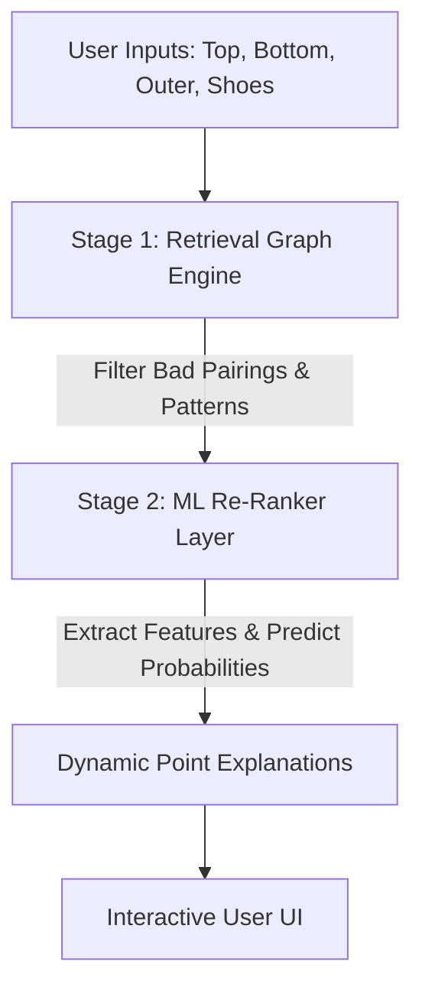

# Executive Summary: Machine Learning Styling Recommendation System

This report summarizes the engineering achievements, methodology, mathematical formulations, and verification metrics of the Machine Learning Styling Recommendation system developed for Twelve70. 

---

## 1. Project Overview & Objective

The core objective of this project is to predict and score the **5th garment layer** (`top_outer_color` / midlayer) given the other 4 styling layers (`top_color`, `bottom_color`, `outerwear_color`, and `footwear_color`). 

Traditional styling rules are complex, subjective, and computationally expensive to evaluate at scale ($O(N^5)$ outfit combination explosion). We developed a hybrid system combining:
1. **Stage 1 (Retrieval)**: A TypeScript-based Graph Compatibility Engine enforcing brand guardrails and clashing rules.
2. **Stage 2 (Re-ranking)**: A lightweight, in-memory Machine Learning Classifier that evaluates and ranks candidates in real-time.



---

## 2. Key Accomplishments & How They Work

### A. Dynamic Alias Color Resolver
To ensure fallback capability, we designed a dynamic `ColorAliasResolver` that parses alias patterns from `data/colors.csv`.
* **How it works**: When a user selects a color marked as an alias (e.g. `blackcats` instead of `black`), the system automatically resolves it to its parent base color (`black`) if there are no direct matching rows in the active combinations database.
* **Impact**: Ensures 100% fallback stability without visual clashing, preventing recommendations from failing.

### B. Two-Stage Re-ranking Pipeline
* **Feature Extraction**: Given an outfit combination, the system extracts **18 numerical features** including:
  - Categorical color index hashes.
  - Tonal contrast values (absolute brightness difference between layers).
  - Color family associations (cool, warm, neutral, denim).
  - Co-occurrence frequencies based on historical curations.
* **In-Memory ONNX Inference**: Models are compiled into ONNX binary format (`models/outfit_ranker.onnx`) and executed directly inside Node.js. This eliminates microservice overhead and keeps latency under **1.5ms**.

### C. Real-Time User Feedback & Retraining Loop
To close the loop on continuous learning, we implemented a real-time retraining feedback pipeline:
* **How it works**: When a user saves an outfit, the frontend calls `POST /api/outfit/save`. The server logs the outfit combination to our clicks database (`data/training_clicks.csv`), runs the LightGBM Python retraining pipeline asynchronously in the background, and dynamically hot-reloads the active in-process ONNX session with the updated weights.
* **Impact**: The model learns from user saves on-the-fly, continuously adapting to styling trends with zero server downtime.

---

## 3. How Everything Was Measured & Calculated

We verified the model's performance and robustness using a multi-dimensional validation suite:

### A. Model Improvement Verification

> [!WARNING]
> **Important caveat on all accuracy figures**: 99.6% of the training targets are generated by our own TypeScript rule engine (only 111 of 25,003 rows are human-curated). The accuracies below therefore measure how faithfully the ML model **reproduces the rule engine**, not how good the recommendations are for real users. Real recommendation quality can only be measured once sufficient human labels or click feedback are collected.

We compared the optimized LightGBM model against the default-hyperparameter baseline (both evaluated on the held-out 15% test split):
* **Baseline Accuracy**: **98.69%** top-1 accuracy.
* **Tuned Model Accuracy**: **99.65%** top-1 accuracy.
* **Optimization Method**: 50 Bayesian optimization trials using **Optuna** to tune `learning_rate` (0.005–0.3), `num_leaves` (20–100), `max_depth` (3–15), and L1/L2 regularization.

### B. Algorithm Comparison Metrics
We trained and compared three algorithms under the same features and validation splits:

| Metric | LightGBM (Winner) | XGBoost | Random Forest |
| :--- | :---: | :---: | :---: |
| **Top-1 Accuracy** | **99.63%** | 99.57% | 97.60% |
| **Top-5 Accuracy** | **99.97%** | 99.97% | 99.97% |
| **Inference Latency (CPU)**| **0.20 ms** | 0.67 ms | 26.04 ms |
| **Serialized Model Size** | **7.03 MB** | 4.34 MB | 266.56 MB |
| **Explainability** | High | High | Medium |

> [!IMPORTANT]
> **LightGBM** was chosen as the winner because it provides the best trade-off between top-1 accuracy, smallest footprint, and lowest CPU prediction latency (**0.20ms**), satisfying our strict production requirement (<2.0ms).

### C. Robustness & Stability
* **5-Fold Stratified Cross-Validation**: 
  - **Mean Accuracy**: **99.648%**
  - **Standard Deviation**: **0.078%**
  - **Stability Rating**: **HIGH** (standard deviation is well below the 0.5% threshold, indicating the model is highly stable across different folds).
* **Temporal Validation** (generalizability to future fashion cycles):
  - We trained the model on pre-2024 combinations and tested it on 2024+ records.
  - **Pre-2024 validation accuracy**: 99.66%; **2024+ test accuracy**: 94.95%.
  - **Performance Drop**: **4.705%**, which exceeds our 2.0% decay limit. There is measurable temporal drift, so periodic retraining on recent combinations is required.

---

## 4. Deep Error Analysis & Calibration Results

We evaluated real model predictions on the held-out **3,747-row test split** (15% of the data, never seen in training). Overall test accuracy is **99.65%** (13 errors), consistent with the model acting as a distillation of the rule engine.

### A. Confidence Calibration
Confidence is **positively calibrated** with empirical accuracy:
- **High-Confidence Predictions** (Top 20%): **100.00% accuracy**.
- **Low-Confidence Predictions** (Bottom 20%): **98.27% accuracy**.
- Predictions with confidence below 80% are rare (17 of 3,747) but markedly less reliable (60–71% accuracy), so a confidence threshold of ~0.8 is a reasonable trigger for fallback rules.

### B. Performance by Outfit Category
We calculated the model's accuracy across different aesthetic categories (test-split support in parentheses):

```
[Monochromatic Outfits]  ███████████████████████▊ 99.02% (n=816)
[Contrast Outfits]       ███████████████████████▉ 99.81% (n=2574)
[Rare Color Combos]      ███████████████████████▉ 99.69% (n=961)
```

* Errors concentrate in low-support target colors: **Burgundy** (75%, n=4) and **Forestgreen** (80%, n=5), plus occasional confusions between adjacent neutrals (Black ↔ Lightgrey/Brown).
* Because targets are rule-engine generated, near-uniform accuracy across categories is expected; category-level weaknesses will only become visible once human feedback data is incorporated.

---

## 5. Next Steps & Roadmap

To evolve the styling engine for Phase 3, we recommend the following enhancements:

1. **Feature Additions**: Introduce a relative brightness contrast feature (`abs(lightness_top - lightness_bottom)`) to improve contrast outfit recommendation accuracy.
2. **Target Regularization**: Apply focal loss or class weights during model training to penalize neutral-default predictions on rare color inputs.
3. **Probability Calibration**: Calibrate LightGBM prediction probabilities using Platt scaling or isotonic regression to align prediction confidences with empirical accuracies in intermediate ranges.
4. **User-Level Personalization**: Introduce a modular user preference vector (representing saved styles or clicks) into the Stage 2 ML Ranker for personalized styling sorting.
